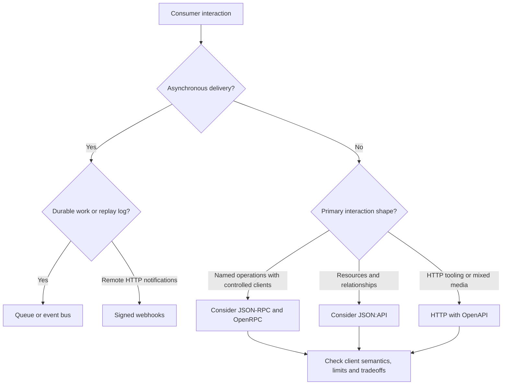

# Choose API protocols

[Documentation map](index.md)

Choose from client expectations, interaction shape and operational constraints,
not whether the caller happens to be internal or external.

| Need | Candidate | Cost or exception |
| --- | --- | --- |
| Named commands/queries, controlled clients, batching | JSON-RPC with optional OpenRPC description | Explicit retry/idempotency contracts; generic HTTP caching and resource tooling are not inherent. |
| Resource browsing, relationships, compound documents and sparse fields | JSON:API | Query complexity, representation rules and extension support need explicit bounds. Action-heavy workflows may fit poorly. |
| Conventional HTTP, generated client ecosystem, gateways, streaming or mixed media | Raw HTTP described by OpenAPI | You still implement handlers, validation, authentication and runtime/description consistency. |
| Notify a remote application asynchronously | Signed webhooks | Delivery attempts, replay protection, deduplication and receiver availability remain application concerns. |
| Durable work distribution, replay or broker retention | Queue or event bus | Operate the broker, settlement/rebalance semantics and consumer compatibility explicitly. |

## JSON-RPC and OpenRPC

JSON-RPC fits an operation-oriented command/query interface, including internal
microservices but also controlled external clients. Explicit method names and
batches can simplify a client's workflow. A notification has no response:
absence of a response is not proof of success. A request ID correlates a reply;
it is not an application idempotency key. Batch members need individual results
and budgets; do not infer atomicity, ordering or parallel execution from a batch.

Separate transport failures, protocol errors and application errors. An unknown
outcome after disconnection cannot become safe retry merely because the method
uses JSON-RPC. Define limits for batch size, payloads and total work. Select a
transport deliberately; protocol semantics do not supply HTTP authorization,
timeouts, streaming or cancellation. OpenRPC describes method contracts and
discovery; link it to runtime tests rather than assuming drift cannot occur.
See [JSON-RPC](https://github.com/faustbrian/go-jsonrpc) and
[OpenRPC](https://github.com/faustbrian/go-openrpc).

JSON-RPC is not an automatic fit for public resource browsing, cache-friendly
HTTP representations, generic gateways or third-party REST expectations.

## JSON:API

JSON:API fits customer, partner or internal resource APIs where standardized
relationships, compound documents, sparse fields, pagination, errors, profiles
and extensions are useful. Filtering and sorting still need application policy
and cost limits; representation conventions do not make arbitrary queries cheap.
Validate supported include depth, page size and allowed fields explicitly.
HTTP caching depends on representation variation, authorization and validators,
not just protocol compliance.

Atomic Operations changes the transaction/error contract; require explicit
support and tests rather than assuming every JSON:API implementation supports
it. Likewise negotiate and document profiles/extensions instead of advertising
unqualified specification completeness. If most work is commands that do not
map naturally to resources, use an operation interface instead of artificial
resource mutations. See [JSON:API](https://github.com/faustbrian/go-jsonapi), its
specification decisions and [protocol comparisons](comparisons/protocols.md).

## Conventional HTTP and OpenAPI

OpenAPI describes an HTTP API; it is not a runtime serialization protocol.
Conventional endpoints are often appropriate for browser/tool compatibility,
gateways, generated clients, files, streaming and mixed media types. Choose
request/response representations and error semantics independently. Test that
the running handler agrees with the description, especially authorization,
validation and error cases. Parsing an OpenAPI document or using a handwritten
handler is not generated-contract evidence. See
[OpenAPI](https://github.com/faustbrian/go-openapi).

## Webhooks and events

For outbound asynchronous HTTP notifications, choose signature coverage and
key rotation, enforce replay windows, bound retries and retention, and give the
receiver a stable deduplication identity. A signature proves the configured
identity/integrity boundary, not authorization to perform arbitrary business
effects. Receiver errors or timeouts can leave unknown outcomes; account for
duplicate delivery and do not promise ordering across retries without a tested
ordering mechanism. Use a queue for worker assignment or an event log when
retention/replay and consumer offsets are the actual requirement. See
[webhooks](https://github.com/faustbrian/go-webhook) and
[HTTP signatures](https://github.com/faustbrian/go-http-signature).

## More than one protocol

A service can expose JSON-RPC commands internally, JSON:API or conventional HTTP
resources externally, and outbound webhooks. Each transport adapter decodes
into application-owned inputs, invokes the same use case, and maps its outcome
into its own transport model. Keep JSON-RPC envelopes, JSON:API resource
documents and HTTP status decisions out of domain logic. Shared use cases do
not require shared transport DTOs. This is architectural guidance, not an
additional verified compatibility-set composition.

Next: [stacks](recommended-stacks.md), [recipes](recipes/index.md),
[architecture](architecture.md).
