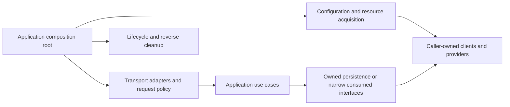

# Architecture and composition roots

[Documentation map](index.md)

The application is the composition root. It selects modules, validates
configuration, acquires resources, constructs policies, installs adapters and
owns lifetime. There is no umbrella module, global registry, service container,
hidden initialization or synchronized release train. The
[design language 1.0](../design-language.md) defines the shared vocabulary.

## Dependency direction

Core owners accept standard-library types or narrow domain contracts. Optional
integrations belong in independently installable nested modules when the extra
backend/SDK is not required by the core. New target-oriented adapters use
`<owner>/adapters/<target>` unless a reviewed domain term applies. An adapter
translates a contract; it does not silently take over transactions, retries,
exporters, broker clients or process shutdown. Released legacy paths remain
supported facades with migration obligations, not names to rewrite casually.

Transport models stop at application boundaries. Persisted schemas, queue
payloads and public wire formats each have their own compatibility lifetime;
replacing a Go package does not authorize changing them together.

## Construction and lifecycle

Use a plain function for stateless work; a validated `New(Config)` or
`New(Options)` for retained state; functional options only for orthogonal
optional settings; and builder/`Compile` or `Build` where registration precedes
an immutable runtime. Acquisition verbs with contexts make external I/O and
ownership visible. These are meanings, not permission to rename package APIs.

Construct dependencies before their consumers. If construction fails, clean up
only successfully acquired resources in reverse order. Register request policy
explicitly, establish readiness only after required dependencies are usable,
and keep probes distinct from business traffic.

At shutdown: withdraw readiness and stop intake; drain accepted work to the
documented boundary; join tasks; close consumers before their transports/pools;
flush caller-owned telemetry within the remaining budget. `Drain`, `Shutdown`,
`Close` and `Wait` are not synonyms. Cancellation can leave an external side
effect unknown; preserve that result rather than promising cancellation rolled
it back. A shutdown budget cannot stop arbitrary callbacks that ignore context.

## Policy order is application policy

An outer observation boundary can see the whole request, including rejections.
Integrity/replay checks, tenant resolution, authentication, authorization,
bounded parsing/validation, dispatch and audit are deliberately ordered by the
application. Do not log sensitive bodies merely to correlate them. Different
protocols may need different decode/verification order. There is no universal
retry/cache/circuit stack: decide whether each policy counts logical operations
or attempts and whether cache hits should consume admission budget.

Next: [ownership map](integration-map.md), [supported stacks](recommended-stacks.md),
[operations](operations/index.md).
